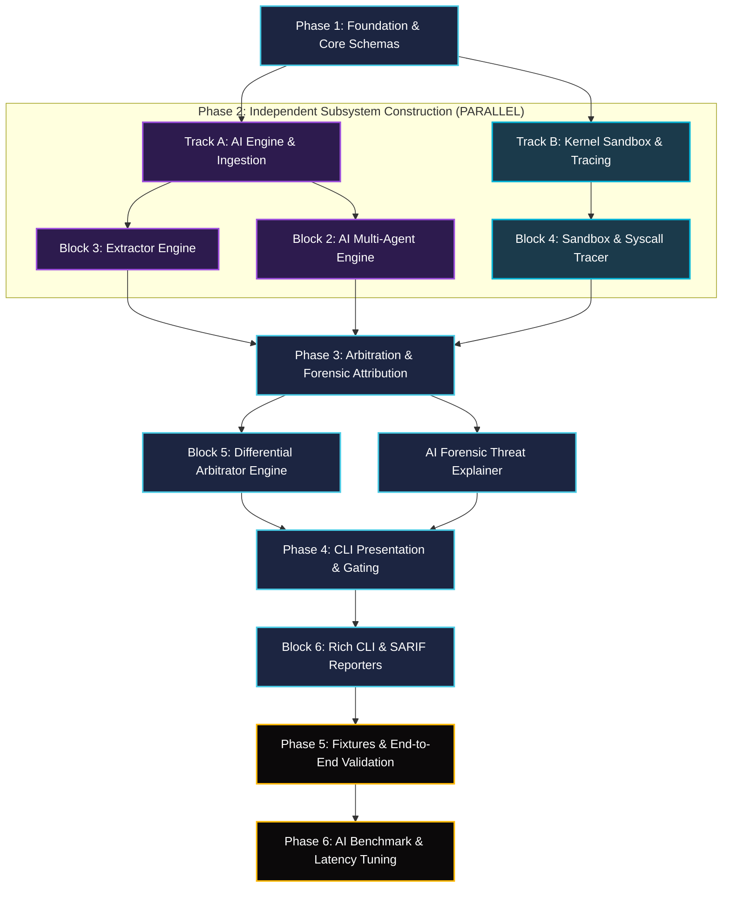

# Implementation & Phased Rollout Plan

## Project: Gatekeeper (*Autonomous Semantic-to-Kernel Drift Detector*)

---

## 1. Implementation Philosophy & Phased Strategy

Gatekeeper is a neuro-symbolic security system with two interdependent pillars:
1. **The Generative AI Pillar**: Natural language understanding, multi-agent cognitive reasoning, AST token correlation, and structured schema compilation.
2. **The Deterministic Kernel Pillar**: Linux namespaces, Bubblewrap containerization, `strace` syscall interception, and mathematical vector arbitration.

To achieve maximum engineering velocity and eliminate architectural bottlenecks, the project follows a **decoupled, test-driven phased implementation model**. Modules that do not share direct runtime dependencies are executed in parallel tracks, while integration checkpoints ensure end-to-end data contract integrity.

---

## 2. Dependency Graph & Parallelization Matrix

The directed acyclic graph (DAG) below visualizes the dependencies between the six core blocks:



### 2.1. Parallel vs. Sequential Execution Matrix

| Subsystem / Block | Execution Mode | Strict Prerequisites | Can Run in Parallel With? |
| :--- | :--- | :--- | :--- |
| **Phase 1: Schemas (`core/schema/`)** | **Sequential** | None (Base typing) | None |
| **Block 3: Extractor (`core/extractor/`)** | **Parallel Track A** | Phase 1 (`core/schema/`) | Block 2 (`core/ai_engine/`), Block 4 (`core/sandbox/`) |
| **Block 2: AI Engine (`core/ai_engine/`)** | **Parallel Track A** | Phase 1 (`core/schema/`) | Block 3 (`core/extractor/`), Block 4 (`core/sandbox/`) |
| **Block 4: Sandbox (`core/sandbox/`)** | **Parallel Track B** | Phase 1 (`core/schema/`) | Block 2 (`core/ai_engine/`), Block 3 (`core/extractor/`) |
| **Block 5: Arbitrator (`core/arbitrator/`)** | **Sequential** | Block 2, Block 4 | None (Requires both EBC and Kernel Trace) |
| **Forensic Agent (`core/ai_engine/forensics`)**| **Sequential** | Block 5 (`core/arbitrator/`) | Block 6 (`cli/`) scaffold |
| **Block 6: CLI (`cli/`)** | **Sequential** | Block 5, Forensic Agent | None (Ties all blocks together) |
| **Phase 5: Validation & Fixtures** | **Sequential** | Block 6 complete | None |
| **Phase 6: AI Benchmarking & Tuning** | **Sequential** | Phase 5 complete | None |

---

## 3. Detailed Phase Breakdown

### Phase 1: Foundation & Core Contracts (Sequential)
*Objective: Establish the immutable typing layer, Pydantic schemas, and host prerequisites.*

1. **Host Environment Verification**:
   - Verify Python 3.10+ runtime and install base dependencies (`pydantic`, `httpx`, `rich`, `pytest`).
   - Confirm local Ollama daemon is accessible (`curl http://localhost:11434/api/tags`).
   - Confirm host `bwrap` and `strace` binaries are present on system PATH.
2. **Schema Subsystem (`core/schema/`)**:
   - Implement `contract.py`: `ExpectedBehaviorContract` model with Pydantic v2 JSON Schema serialization.
   - Implement `telemetry.py`: `ObservedKernelTrace` model with Set-based file, network, and binary attributes.
   - Implement `forensics.py`: `ThreatAttributionReport` model.
   - Write unit tests in `core/schema/tests/test_schema.py`.
   - Initialize and document architectural rationale in `core/schema/ai_decisions.log`.

**Phase 1 Quality Gate**:
`pytest core/schema/tests/` passes with 100% code coverage. Pydantic emits valid JSON Schema conforming to Ollama structured output specifications.

---

### Phase 2: Parallel Subsystem Construction (Track A & Track B)
*Objective: Build static ingestion, generative AI reasoning, and low-level kernel isolation concurrently.*

#### Track A: AI Engine & Ingestion (Blocks 2 & 3)
1. **Extractor Engine (`core/extractor/`)**:
   - Implement `manifest_parser.py`: Ingests `package.json` (NPM hooks) and `setup.py` / `pyproject.toml` (Python hooks).
   - Implement `ast_inspector.py`: Tree-Sitter parser extracting suspicious imports, string entropy, and network/child-process AST tokens.
   - Implement `runner_builder.py`: Writes inline commands to standalone executable scripts (`.sysdrift_<hook>.sh`).
   - Write tests in `core/extractor/tests/test_extractor.py`.
   - Record design choices in `core/extractor/ai_decisions.log`.
2. **AI Multi-Agent Engine (`core/ai_engine/`)**:
   - Implement `client.py`: Async HTTPX connection pool to Ollama daemon on port `11434`.
   - Implement `prompts.py`: Conservative, air-gapped system prompts and Pydantic schema injection templates.
   - Implement `agents.py`:
     - `IntentSynthesizerAgent`: Analyzes natural language purpose and documentation.
     - `AdversarialRedTeamAgent`: Probes for deceptive comments and prompt injections.
   - Implement Grammar-Guided Decoding: Enforce `format="json"` with automated reflection retry loops.
   - Write mock tests in `core/ai_engine/tests/test_ai_engine.py`.
   - Record design choices in `core/ai_engine/ai_decisions.log`.

#### Track B: Kernel Sandbox & Telemetry (Block 4)
1. **Sandbox Subsystem (`core/sandbox/`)**:
   - Implement `bwrap.py`: Unprivileged Bubblewrap runner with read-only mounts (`/usr`, `/lib`, `/bin`), ephemeral `/tmp`, and isolated PID namespace (`CLONE_NEWPID`).
   - Implement `tracer.py`: Wraps Bubblewrap inside `strace` filtered for `openat`, `connect`, and `execve`, with a hard 20.0s timeout.
   - Implement `log_parser.py`: Regex stream parser extracting file paths, IP:port sockets, and executed binary basenames into `ObservedKernelTrace`.
   - Write tests in `core/sandbox/tests/test_sandbox.py` (with mocked strace streams for non-Linux CI runners).
   - Record design choices in `core/sandbox/ai_decisions.log`.

**Phase 2 Quality Gate**:
Both Track A and Track B unit test suites pass independently. Extractor generates valid runner scripts, AI Engine produces valid EBC contracts from mock manifests, and Sandbox parses synthetic strace logs accurately.

---

### Phase 3: Arbitration & Forensic Attribution (Sequential)
*Objective: Implement mathematical vector drift scoring and the post-trace AI Forensic Explainer.*

1. **Differential Arbitrator (`core/arbitrator/`)**:
   - Implement `heuristics.py`: Hardcoded sensitive paths (`.ssh`, `.aws`, `.env`, `.kube/config`) and system runtime noise filters (`node`, `bash`, `python3`).
   - Implement `scorer.py`: Weighted vector formulation:
     $$D = (0.45 \cdot D_{\text{net}}) + (0.35 \cdot D_{\text{fs}}) + (0.20 \cdot D_{\text{proc}})$$
   - Implement `violations.py`: Categorizes discrepancies into actionable diagnostics.
   - Write tests in `core/arbitrator/tests/test_arbitrator.py`.
   - Record design choices in `core/arbitrator/ai_decisions.log`.
2. **AI Forensic Threat Explainer (`core/ai_engine/forensic_agent.py`)**:
   - Triggered when $D \ge 0.40$.
   - Synthesizes the `ThreatAttributionReport`, mapping kernel events back to AST code snippets and tagging applicable MITRE ATT&CK techniques (`T1552`, `T1071`).
   - Generates executive summaries and mitigation advice.

**Phase 3 Quality Gate**:
Arbitrator correctly calculates $0.00$ drift for nominal traces and $\ge 0.80$ drift for traces touching AWS credentials or remote IPs. Forensic agent emits complete MITRE-annotated reports.

---

### Phase 4: CLI Application & Presentation Layer (Sequential)
*Objective: Build the user-facing CLI, rich terminal layouts, and automated CI exit code enforcement.*

1. **CLI Orchestrator (`cli/`)**:
   - Implement `main.py`: Command-line dispatcher with argument parsing (`target_dir`, `--format`, `--threshold`).
   - Implement `ui.py`: Rich terminal presentation:
     - Header banner.
     - Dynamic status spinners during extraction, synthesis, and sandboxing.
     - Side-by-side Comparison Matrix Table.
     - Red Alert Quarantine Card / Green Approval Card.
     - AI Forensic Attribution Panel.
   - Implement `reporters.py`: JSON export and SARIF v2.1.0 output for GitHub Security tab integration.
   - Implement Exit Code Contract: Return `0` for ALLOW, `1` for QUARANTINE, `2` for ERROR.
   - Write CLI integration tests in `cli/tests/test_cli.py`.
   - Record design choices in `cli/ai_decisions.log`.

**Phase 4 Quality Gate**:
Running `gatekeeper run --help` displays clean documentation. Running against mock fixtures outputs formatted Rich tables and returns expected POSIX exit codes.

---

### Phase 5: Verification Fixtures & End-to-End Validation (Sequential)
*Objective: Validate accuracy and performance against real-world benign and malicious package fixtures.*

1. **Build Standard Test Fixtures**:
   - `fixtures/benign-canvas/`: Compiles local native helper via `touch` without touching the network.
   - `fixtures/malicious-telemetry/`: Simulates credential theft targeting `~/.aws/credentials` and connecting to remote socket `194.26.29.112:443`.
   - `fixtures/evasive-obfuscated/`: Simulates base64 `eval()` reverse shell with deceptive code comments.
2. **End-to-End Execution & Validation**:
   - Run Gatekeeper against `benign-canvas`: Confirm Drift Score $= 0.00$ and Exit Code `0`.
   - Run Gatekeeper against `malicious-telemetry`: Confirm Drift Score $\ge 0.80$, Quarantine Alert, AI Forensic Breakdown, and Exit Code `1`.
   - Run Gatekeeper against `evasive-obfuscated`: Confirm that adversarial comments do not bypass the Red-Team Agent or kernel tracing.

**Phase 5 Quality Gate**:
100% detection rate on malicious fixtures with zero false positives on benign fixtures. All exit codes verify correctly in CI test scripts.

---

### Phase 6: AI Benchmarking & Latency Tuning (AI Depth)
*Objective: Benchmark the open-weight SLM, optimize prompt performance, and enforce latency budgets.*

1. **Model Evaluation Harness**:
   - Benchmark `Qwen2.5-Coder:7B` across 50 diverse package manifests.
   - Measure schema compliance rate (target: 100% with Pydantic JSON Schema enforcement).
   - Measure inference latency across quantizations (Q4_K_M vs. Q8_0).
2. **Prompt Optimization & Token Budgeting**:
   - Ensure input prompts stay within a strict 2,048-token context window budget.
   - Optimize Tree-Sitter AST snippet extraction to send only high-signal code tokens rather than entire minified vendor files.
3. **Execution Latency Profiling**:
   - Verify total end-to-end scan latency remains under **6.0 seconds** per package.

---

## 4. Subsystem AI Decision Log Tracking Requirements

To maintain architectural transparency and provide auditability, every subsystem directory in the repository must maintain an active `ai_decisions.log` file. Whenever an architectural choice, refactor, or trade-off is implemented, an entry must be appended following this standardized template:

```text
[DECISION-<BLOCK_NAME>-<ID>] <Concise Title>
- Timestamp: <ISO-8601 Date/Time>
- Subsystem: <e.g., core/ai_engine, core/sandbox>
- Problem Context: <Description of engineering trade-off or challenge>
- Decision Made: <Chosen implementation, technology, or algorithm>
- Alternatives Considered: <Rejected options and why they were declined>
- Rationale & Security Invariants: <Why this choice protects against supply chain attacks>
- Test Verification: <Which test file verifies this decision>
```

---

<div align="center">
  <sub>Gatekeeper Implementation Plan • Confidential & Open-Source Engineering Specification</sub>
</div>
